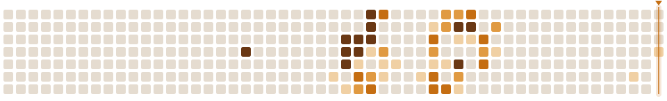

<picture>
  <source media="(max-width: 640px) and (prefers-color-scheme: dark)" srcset="./assets/title-mobile-dark.svg">
  <source media="(max-width: 640px) and (prefers-color-scheme: light)" srcset="./assets/title-mobile-light.svg">
  <source media="(prefers-color-scheme: dark)" srcset="./assets/title-dark.svg">
  <source media="(prefers-color-scheme: light)" srcset="./assets/title-light.svg">
  
</picture>

Motion designer and video editor. Onchain builder on Somnia.

19\. BD at [Mojo](https://app.mojo.trade). Studying Information Systems & Programming.

Adobe Premiere and After Effects. C#, C++, SQL, HTML, and databases.

[X @ShinyViq](https://x.com/ShinyViq)

<picture>
  <source media="(prefers-color-scheme: dark)" srcset="./assets/rule-dark.svg">
  <source media="(prefers-color-scheme: light)" srcset="./assets/rule-light.svg">
  
</picture>

**Sequence**

**01 · [ShinyLuck](https://github.com/pSJLq/ShinyLuck)**

On-chain casino and no-limit hold'em on Somnia. Casino bets are commit-reveal keccak256, so anyone can recompute them. Poker is mental poker: the players shuffle the deck, and no server sees a hole card before showdown. Live on testnet.

[shinyluck.win](https://shinyluck.win)

**02 · [ShinyAudit](https://github.com/pSJLq/ShinyAudit)**

Agentic on-chain investigator for Somnia. A swarm of agents reads the chain from a plain-English question and leaves a verifiable receipt for each step. Somnia Agentathon 2026.

[shinyaudit.vercel.app](https://shinyaudit.vercel.app)

**03 · [Dreamdex-bot](https://github.com/pSJLq/Dreamdex-bot)**

Trading bot for the dreamDEX Dev Traders Program on Somnia mainnet.

**04 · [Shinia](https://github.com/pSJLq/Shinia)**

The best onchain game. A UE5 shooter on Somnia: every kill is written on-chain, and Somnia Reactivity pushes the killfeed, the scores, and the match result.

**05 · Catharsis**

Onchain SkyBlock-style MMO on Somnia. Coming soon.

<picture>
  <source media="(prefers-color-scheme: dark)" srcset="./assets/rule-dark.svg">
  <source media="(prefers-color-scheme: light)" srcset="./assets/rule-light.svg">
  
</picture>

**Dailies**

The last year, as frames.

<picture>
  <source media="(prefers-color-scheme: dark)" srcset="./assets/dailies-dark.svg">
  <source media="(prefers-color-scheme: light)" srcset="./assets/dailies-light.svg">
  
</picture>
